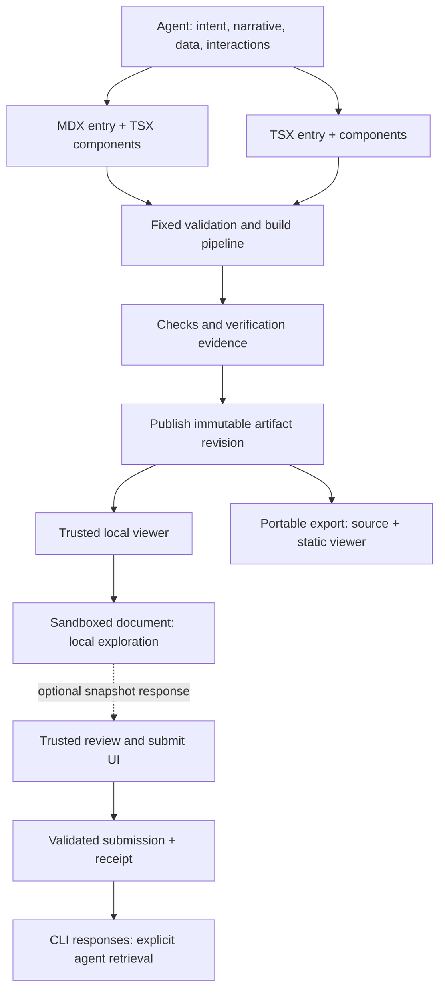
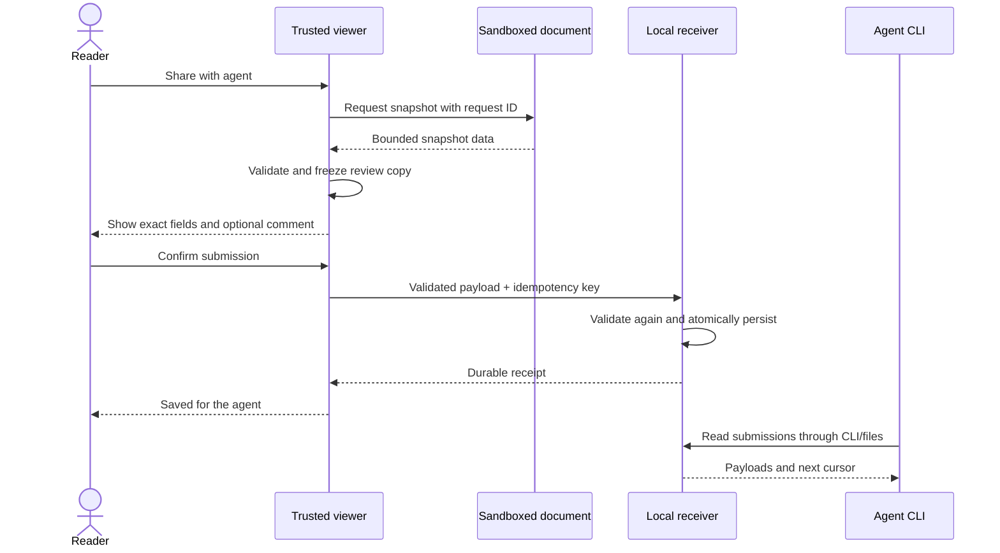

# Explorable document — design and implementation plan

**Status:** v1 implemented 2026-10-24; acceptance evidence is tracked in
[progress](../progress/v1.md). Requirements: [PRD](../req/prd.md).

Runtime 0.2.0 extension: [reusable diagram primitives](diagram-primitives.md), approved and implemented through the [D1–D4 tracker](../progress/diagram-primitives.md).

Runtime 0.3.0 extension: [accessible chart frame](chart-frame.md), with bounded line/part-to-whole plots and native inspection. Acceptance is tracked in [C1–C4](../progress/chart-frame.md).

Runtime 0.4.0 extension: [form and code utilities](form-code-utilities.md) — controlled native fields, raw numeric drafts and selectable source/JSON panels. Acceptance is tracked in [F1–F4](../progress/form-code-utilities.md).

## 1. Decision summary

`explorable-document` produces source-backed explanations that a reader can explore
through prose, custom visuals, and working interactions. It is a **Contract × Authored**
skill, initially at `plugins/experiment/skills/explorable-document/`.

| Concern | Decision |
|---|---|
| Authoring | MDX and TSX in v1; one React/TypeScript toolchain and component kit |
| Default experience | Independent local exploration, with no answer requirement |
| Optional handoff | Reviewed snapshot; explicit submission and agent retrieval |
| Rendering target | Local browser; portable multi-file static export |
| Durable storage | `~/.lightbridge/projects/<project-key>/explorable-documents/` |
| Artifact lifecycle | Save by default, immutable revisions, reopen without compilation |
| Runtime code | Sandboxed open-ended document inside a controlled viewer |
| Core delivery | Thin Python CLI; fixed Node/pnpm build tooling; no new agent host |
| Visual direction | Screenshot-inspired ChatGPT Intelligent UI: neutral surfaces, prose-integrated figures, restrained semantic accents |
| Deferred | Live agent integration, protocol adapters, single-file export, remote services |

**Reading map:** §§2–4 explain the architecture and authoring contract; §§5–7 specify
delivery, handoff, and persistence; §§8–9 define the CLI and package; §§10–11 are the
verification and implementation checklist. The dependency catalog and screenshot-based
visual direction are accepted. Light-mode styling will be developed during implementation
and reviewed with the first rendered fixture.

## 2. Architecture and ownership



| Owner | Responsibility | Does not own |
|---|---|---|
| Skill instructions | Routing, intent, interaction design, author/verify/present workflow | A general frontend programming tutorial |
| Python CLI | Project resolution, staging, publication, viewer lifecycle, submissions, diagnostics | JSX rendering or domain calculations |
| Fixed build toolchain | MDX compilation, TSX transforms, bundling, type/static checks, asset processing | Artifact-provided scripts, plugins, or build configuration |
| Document code | Narrative, local state, custom visuals, pure calculation functions | Trusted viewer DOM, filesystem, tools, submission authority |
| Trusted viewer | Identity, theme, fallback, frame hosting, snapshot review, reader actions | Interpreting domain results as authoritative measurements |
| Lightbridge | Canonical project identity and registered state location | Document renderer implementation |

Keep MDX compilation, the component kit, and the viewer bridge together: their
contracts will evolve together. Reuse Lightbridge through its public CLI. Do not
import private `rich-document` or `ask-form` renderer/server internals, or extract a
shared UI framework during v1. Their existing delivery conventions are precedents;
their different trust boundaries and lifetimes remain separate.

## 3. Authoring contract

### Source package

```text
queue-explorer/
  artifact.json
  document.mdx                # or document.tsx; one declared entry
  queue-scenario.tsx          # only when needed
  model.ts                    # only when needed
  styles.css                  # optional document-local styles
  data/                       # optional declared data/assets
  tests/                      # meaningful checks, not boilerplate
```

`artifact.json` is the sole owner of metadata; do not duplicate it in MDX frontmatter.
A TSX entry exports a document component. An MDX entry compiles to the same component
interface. Both may import local TS/TSX, approved dependencies, declared JSON data,
and assets. Source boundaries reject traversal and symlinks escaping the source root.

Use MDX for narrative-led explanations and TSX for visual-led workspaces. MDX supports
prose with JSX, expressions, and imports; compiling it produces JavaScript that must
subsequently run. It is not inert Markdown. [MDX documentation](https://mdxjs.com/docs/using-mdx/)

Prose and composition stay in MDX; substantial behavior stays in TSX; calculations
stay in testable functions. Ordinary React context/state connects multiple components
inside a document. There is no formula DSL or second event execution language.

### Descriptor

The versioned JSON Schema is the authoritative field definition; the following is
the v1 shape, with handoff omitted intentionally:

```json
{
  "schema_version": 1,
  "title": "Queue saturation explorer",
  "summary": "Explore how arrival and service rates affect a simple queue.",
  "entry": "document.mdx",
  "layout": "article",
  "assets": [],
  "data_sources": [
    {"id": "model", "kind": "illustrative", "description": "Idealized queue model"}
  ],
  "interactions": [
    {
      "id": "arrival-rate",
      "trigger": "Change arrival rate",
      "input_schema": {"type": "number", "minimum": 0, "maximum": 20},
      "outputs": ["queue-diagram", "scenario-summary"],
      "expected": "Both views reflect the current rate and show overload explicitly"
    }
  ]
}
```

Required: schema version, title, text fallback summary, entry, and interactions
(an empty list is valid for an artifact whose custom visual needs no controls).
Layout defaults to `article`; assets and data sources default to empty lists.
`handoff` is optional; when absent, the capability is unavailable.

Titles, IDs, summaries, and payloads have finite schema bounds. Initial engineering
limits: 200-character titles, 4,000-character summaries, 64-character IDs,
100 declared interactions, 64 KiB descriptor, 10 MiB authored text, 50 MiB declared
data/assets, 100 MiB rendered output, and 1 MiB submitted JSON. Boundary tests cover
each limit. Increase a bound through a reviewed schema/toolchain change if fixtures
demonstrate a need; do not silently truncate data or drop controls.

Data declarations identify synthetic/illustrative versus sourced inputs, with source
reference, units, and retrieval/version information where meaningful. Asset paths
are relative and explicit; a citation URL is metadata, not permission to fetch it.
Additional descriptor properties and unsupported schema versions fail with a location
and repair hint. External schema references and executable configuration are rejected.

### Interaction declarations

Declare primary semantic interactions, not every hover or focus change. Each has an
ID, trigger, input schema, affected output IDs, and expected visible effect. Use stable
DOM IDs or test hooks to connect declarations to browser checks. Displayed labels may
change without changing identity. Input schemas document valid values; component code
still implements validation, with tests checking consistency.

Declarations are claims and test targets, not proof that arbitrary code obeys them.
Every primary interaction must have evidence before an artifact is called verified.
Initial state lives in component/model code; avoid duplicating mutable defaults in
metadata. Invalid input, empty selection, reset, and edge-case results are explicit
behaviors rather than fabricated successes.

### Build and dependencies

Use a maintained React/TypeScript/Vite pipeline with MDX integration and GFM support.
Common prose, tables, links, fenced code, imported components, and custom SVG are in
v1. Math rendering, Mermaid-specific adapters, and specialized chart/editor libraries
are extensions when a demonstrated use case warrants them; SVG/custom JSX is already
available for diagrams and infographics.

Vite provides static production bundles, but TypeScript checking is a separate step.
Run `tsc --noEmit` for TS/TSX; do not claim it fully checks expressions or component
props inside MDX. MDX compilation, fixture execution, and browser checks cover that
remaining boundary. [Build documentation](https://vite.dev/guide/build),
[TypeScript documentation](https://vite.dev/guide/features#typescript).

**Accepted 2026-10-24:** v1 uses a fixed dependency catalog; individual documents
cannot install arbitrary npm packages. New libraries require a toolchain update.

Pin the tested Node/pnpm versions, runtime dependencies, compiler plugins, format/lint
tools, and test tools during S1. Store the package-manager version and engine constraint
in the maintained package manifest, with a committed lockfile and frozen installs.
Do not claim specific supported versions before testing them. The runtime package
manifest owns its version; artifact manifests derive it. Schema version and skill
instruction date are separate compatibility identifiers.

Use the official scaffold to establish the maintained template once, then reuse its
fixed configuration. Never load caller Vite configuration, dotenv files, package
scripts, plugins, or surrounding workspace settings. Compile staged source; do not
evaluate/SSR MDX on the host. Reject Node built-ins, remote imports, unapproved packages,
and imports outside staged source or the fixed toolchain.

Build work and dependency installation occur outside the installed skill directory,
using disposable staging and the normal package-manager cache. Do not ship or persist
`node_modules`. Startup/install/network failures report dependency errors without
falling back to an unpinned toolchain. This is controlled execution, not a claim of an
OS sandbox against malicious dependencies or generated tests.

## 4. Presentation and generative UI contract

**Runs in:** an owned local browser surface; a static exported viewer uses the same
document payload. **Model emits:** executable MDX/TSX content plus structured metadata.

| Surface | Tier and reason | Transport/format |
|---|---|---|
| Viewer identity, theme, status | Controlled: frequent shared surfaces and fixed status semantics | Validated manifest hydrated into shipped components |
| Document body and custom interactions | Open-ended: task-specific visuals cannot all be predesigned | Compiled browser code in an opaque-origin sandbox |
| Snapshot review and submission | Controlled: fixed reader action and exact reviewed payload | Versioned, schema-validated bridge messages and JSON |

There is no separately advertised Declarative UI renderer in v1. A reusable React kit
does not change executable document code into schema-only UI. The Open-ended choice
deliberately accepts layout variation for custom exploration; the rest of the viewer
remains fixed. No clinical action surface or PHI belongs in this tier.

### Controlled catalog

All strings render as text. Data is copied from validated metadata, receiver receipts,
or the reviewed snapshot; arbitrary tool-result paths are unsupported. Viewer action
labels are fixed. Artifact titles, summaries, snapshot field descriptions, and source
references are author-supplied within schema limits.

| Component | Props/defaults | Actions and data sent | Placement, cardinality, mobile | Representative intents |
|---|---|---|---|---|
| `ArtifactHeader` | Required title/id; optional summary defaults empty | None | One in header; wraps | Identify this explanation; reopen a saved explanation |
| `ReaderControls` | Theme enum system/light/dark, defaults system | `setTheme(enum)` only to local viewer/document | One in toolbar; controls wrap, no clipped actions | Read in dark mode; follow system appearance |
| `ArtifactStatus` | Required build/check state; optional bounded diagnostic list | None | One status region; text fallback replaces failed body | Explain a render failure; show what was verified |
| `HandoffControl` | Present only with handoff schema and transport capability | `requestSnapshot(requestId)` after reader action | At most one in toolbar; label becomes Download snapshot in static/temporary mode | Share current assumptions; export selected results |
| `SnapshotReview` | Required validated field/value tree; optional reader comment, max 4,000 chars | Submit exact reviewed bytes or download them; cancel sends nothing | At most one modal; full-width on small screens; keyboard focus contained/restored | Review what will be sent; add a note to selected results |
| `SubmissionReceipt` | Required submission ID/status/time supplied by receiver | None | At most one current receipt within review UI | Confirm a snapshot was saved; recover after a failed submission |

Fixed composition: header (`ArtifactHeader` once, `ReaderControls` once, optional
`HandoffControl`) → status region (`ArtifactStatus` once) → main (one document frame,
or fallback) → optional review overlay (`SnapshotReview` once with zero/one receipt).
Generated markup never fills a trusted shell slot. No arbitrary header/footer injection.

### Document kit and reader experience

Offer `Document`, `Section`, `Figure`, and `ExplorePanel` primitives plus accessible
form-control wrappers. Semantic HTML remains valid without a wrapper. Use native
controls before adding elaborate interactions. Source order is reading order; figures
need an accessible description or equivalent table/text, and animation respects
reduced-motion preferences. Document CSS stays inside the frame.

Two initial presets: `article` for prose with embedded visual panels, and `workspace`
for a wider coordinated view. Both stack on narrow screens. They are layout starting
points, not a catalog restriction on custom document content.

**Visual direction revised 2026-10-24:** use the supplied ChatGPT Intelligent UI
screenshots as the visual reference. Do not inherit the `rich-document` theme,
palette, or styling assets. Its artifact lifecycle remains an architectural precedent.

### Visual reference and composition

The reference set contains thirteen screenshots, including six `diagram-*` images.
The observations below describe visible composition. They do not establish ChatGPT's
implementation framework, original CSS units, font family, hover behavior, or whether
the pictured controls worked. Screenshot scale must not be copied as CSS pixel sizes.
These descriptions preserve the design direction without making local screenshot
files a build dependency or shipping them in the skill.

| Reference | Observed visual pattern | Application to this skill |
|---|---|---|
| `diagram-layered-agent-architecture.png` | A rounded figure boundary, stacked architecture layers, two parallel responsibility cards, sparse directional connectors, and an explanatory caption | Compose architecture figures from readable HTML groups with SVG connectors where needed; preserve the hierarchy on narrow screens |
| `diagram-short-vs-long-coupling-distance.png` | Two labeled relationship examples, compact nodes, a central transition, and generous whitespace | Use a comparison figure with an explicit progression; encode the distinction in labels as well as position |
| `diagram-coupling-dimensions-concept-grid.png` | Three aligned concept columns with small outline icons, strong titles, short subtitles, and explanatory questions | Use a responsive concept grid embedded directly in the narrative |
| `diagram-workflow-shared-knowledge.png` | Blue-outlined nodes and arrows above a spanning orange dashed annotation connected to the flow | Support labeled nodes, directional links, group boundaries, and annotations as distinct visual roles |
| `diagram-service-contract-with-code.png` | A code panel beside the surrounding explanation, followed by a figure with service boundaries, an internal detail, and a highlighted interface between services | Pair code and diagrams in reading order; use nesting and selective emphasis to explain what crosses a boundary |
| `diagram-integration-strength-card-spectrum.png` | Four stacked colored cards with numbers, titles, explanations, outline icons, and spectrum endpoint labels | Use ordered cards for a conceptual spectrum; preserve the order and text meaning independently of color |
| Metric, form, table, stepper, and local-state references | Quiet outlined panels, compact headings, pill controls, labeled inputs, prominent values, and local legends/captions | Share tokens across controls and figures; keep inputs and the outputs they explain visually close |

The resulting visual language is a continuous explanatory document with purposeful
figures. Prose introduces the question, a visual makes its structure visible, and
nearby text explains the consequence. Keep persistent viewer chrome compact so the
artifact reads as an explanation. A figure can be static when that already conveys
the idea; do not make every box clickable or require a control count.

**Theme and tokens — Neutral Canvas.** Use a neutral near-black dark canvas, soft off-white primary
text, muted gray supporting text, subtle gray borders, and a small number of raised
neutral surfaces. Use blue for selection/structural emphasis, with green/teal and
orange available for distinct semantic roles. A figure's labels or legend define its
meaning; a color is not a universal domain category. Orange remains an occasional
annotation accent rather than the global warm accent of the previous proposal.
Use shared semantic CSS variables for canvas, panel, border, text, muted text, focus,
selection, and diagram accents. All document primitives and the trusted viewer consume
their appropriate theme values; actual values are owned by the maintained runtime.

The viewer title, subtitle, and reference line are centered. The theme control sits
at the top right; on narrow screens it occupies a separate row above the centered
identity block so controls and text never overlap. The theme selector uses an
accessible name without a visible helper label; the status line is centered and
uses quieter gray text with readable contrast in both themes.

**Typography and shape.** Use a locally available system sans-serif stack and monospace
for code. Establish hierarchy through size, weight, and spacing; use generously rounded
figure/panel boundaries, smaller node radii, pill-shaped actions, and restrained
outline icons. Default panels have thin borders and little or no shadow. Preserve
whitespace around diagram relationships instead of filling the figure with nodes.
Exact token values are implementation choices validated by the first rendered fixture,
not claims to have recovered official ChatGPT design tokens.

**Diagram authoring.** Provide two compositional recipes in the skill reference:

1. **HTML/CSS composition:** concept grids, architecture layers, responsibility cards,
   before/after comparisons, and narrative steps. Use normal document flow for text and
   responsive reflow; add small SVG connectors only when relationships need them.
2. **SVG or mixed HTML/SVG figures:** node/link flows, nested boundaries, spanning
   annotations, and spatial relationships. Keep labels legible and selectable where
   feasible, with a text equivalent. Custom geometry remains available in TSX.

Reuse the existing panel/figure primitives; add a small set of node, connector, and
annotation helpers only where the reference fixtures demonstrate repetition. These
are composable rendering aids, not a new graph DSL or mandatory graph-layout library.
MDX embeds the resulting components; TSX owns custom geometry and interaction.
Diagram labels, captions, connectors, and selection states follow the same tokens
as the prose and controls. Imported data is escaped as text.

**Interaction and responsive behavior.** Selected nodes or steps may reveal nearby
detail, highlight a path, or update coordinated prose when useful. Each such behavior
must have a real handler, keyboard equivalent, and declared verification target.
For narrow screens, reflow card-based diagrams and change flow direction where semantics
permit. For irreducibly spatial figures, provide a bounded overflow/expanded view and
an accessible explanation rather than shrinking all text to fit. Every visible arrow
must retain its intended connection after resizing. Selected state needs more than
color alone; reduced motion must preserve the explanation.

The examples' Run and conversational-action affordances do not add code execution or
agent wake-up to v1. Only implement controls for the agreed capabilities, with visible
success/failure behavior. Copy/export controls use the applicable browser or trusted
viewer capability and report denial rather than implying success.

**Accepted 2026-10-24:** develop light mode during implementation as a neutral counterpart
with the same hierarchy and semantics, and review it with the first rendered fixture.
The references show dark mode only; light mode is an authored interpretation.

Visual acceptance must cover a concept grid, a layered architecture figure, and a
node/connector figure with a group annotation, integrated with MDX prose. Use synthetic,
non-clinical content. These can be sections of one reference page rather than additional
applications. Inspect both themes at wide/narrow widths alongside the reference patterns;
judge hierarchy, spacing, legibility, and relationship clarity rather than screenshot
pixel equality. Do not copy oversized screenshot text literally. The first fixture
sets the visual baseline before expanding the kit.

Theme is reader-controlled and passed into the frame without resetting local state.
Document inputs live in memory. No automatic unsent-state persistence or restoration
is promised. Handoff absence removes its UI and receiver route; exploration has no
completion counter, required answers, deadline, or implicit cancellation.

## 5. Viewer isolation and delivery

The trusted shell and generated document must not share execution privileges. Implemented
v1 boundary: a sandboxed `srcdoc` frame with `allow-scripts` only, an
opaque origin, and a bundled/inlined inner payload. The outer static bundle may contain
multiple files. The inner payload must not require credentialed module fetches or
same-origin access to initialize. Prove this for both MDX and TSX in S1.

Do not enable `allow-same-origin` to make a failing bundle work. Browser documentation
warns that combining it with scripts on a same-origin frame can defeat sandboxing.
[Iframe sandbox reference](https://developer.mozilla.org/en-US/docs/Web/HTML/Reference/Elements/iframe#sandbox).

Enforce CSP and Permissions Policy appropriate to each surface: no remote script/font/
image dependencies, no direct document connections, no native form submission, no
popups, no parent navigation, no camera/microphone, and no arbitrary nested frames.
Bundle required assets and use no-referrer. Only the shell holds receiver credentials;
none enter the document payload or exported artifacts. External links are explicit
reader navigation, mediated through the viewer rather than automatic data fetching.

An iframe plus CSP is not a complete network or resource-exhaustion sandbox. Frame
self-navigation and browser-policy gaps must be assessed in S1; do not claim adversarial
zero-egress containment from a clean network trace. The acceptance claim is isolated
viewer privileges plus no unexpected runtime requests during tested interactions.
Sensitive data stays out. Stronger hostile-code containment would require a separately
designed browser/OS boundary.

Bootstrap a dedicated MessageChannel with the exact child window. Bind the channel to
this viewer instance, protocol version, and artifact revision; do not trust `origin:
null` alone. Validate message types, request IDs, payload bounds, and session identity;
reject unsolicited snapshot responses and messages from other frames. Allowed messages:
initialization, theme, ready/error, bounded sizing, snapshot request/response, and
explicit link intent. No generic RPC, arbitrary URL fetch, shell command, or tool call.

Serve on `127.0.0.1` with a random port and capability token. Check Host/Origin and
serve only declared built files; reject traversal, directory listing, unexpected
methods, and unbounded bodies. State-changing routes require a session-scoped token;
do not log capability URLs. Temporary runtime records contain process/port/token
information and are never part of the archive.

The viewer remains available until explicit stop or process/OS shutdown. Closing a tab
is neither submission nor reliable shutdown. `present` returns after readiness without
waiting for the reader; `serve` provides a foreground fallback when a harness reaps
detached children. Readiness proves delivery, not visual correctness or human reading.

## 6. Optional snapshot handoff

Enable handoff only when the task benefits from returning selections or assumptions,
or when explicitly requested. An enabled document remains fully usable without sending
anything. Its descriptor references a local JSON Schema for the exported snapshot;
properties are explicit, bounded, and closed to extras at every object level. The
schema supports JSON values, not HTML, functions, filesystem paths, or arbitrary refs.

The document registers one snapshot provider through the shipped runtime API. It
returns the current declared inputs, selections, and relevant derived values when
requested. Absence or failure of a required provider is visible and blocks sharing,
not exploration. Domain results remain document-produced values, not trusted backend
facts merely because their JSON validates.



Review freezes the payload; further exploration cannot silently alter what Submit
sends. Refreshing the review explicitly requests a new snapshot. Comments are typed
in the trusted shell. The document cannot confirm a submission, forge a durable
receipt, or directly invoke the write route.

The server owns artifact ID, revision/hash, schema version, submission ID, and time.
Validate values against that exact revision's schema. Retries with the same
idempotency key and identical payload return the same receipt; conflicting reuse is
rejected. Multiple intentional submissions are allowed. Failures retain the review
copy for retry or download and never display Saved prematurely.

No slider movement is sent to the receiver or agent. Reading responses is explicit,
non-destructive, bounded, and cursor-based; it does not wake an agent or authorize an
external action. Do not display Read by agent without an actual acknowledgment
mechanism; v1 only reports Saved for the agent.

Static exports and `--no-save` use snapshot download instead of durable submission.
They carry no live receiver URL or credentials. Revisions retain separate submission
histories; v1 does not migrate old snapshots into a changed input/schema contract.

## 7. Persistence, revisions, and export

```text
~/.lightbridge/projects/<project-key>/explorable-documents/
  artifacts/
    <artifact-id>/
      manifest.json
      source/                   # authored sources, declared data/assets
        _toolchain/             # exact rebuild code, config, package and lockfile
      rendered/                 # trusted shell + isolated compiled payload
      verification.json
  submissions/
    <artifact-id>/
      <submission-id>.json
```

Resolve project scope through `lb path --json`, using invocation cwd rather than source
path. Register this feature-owned subtree in the Lightbridge catalog; do not add a
config section just for always-on persistence. The CLI owns writes. Existing
`rich-document` artifacts and `ask-form` records retain their formats.

`_toolchain` is reserved and compiler-owned. Preserve all transitive authored source,
declared input assets, licenses/notices, exact build scripts/configuration, and lockfile;
exclude caches, secrets, environment files, capability tokens, and `node_modules`.
Hash the source closure, toolchain, and rendered files. The manifest records identity,
creation time, optional parent artifact ID, source format, schema/toolchain versions,
relative entrypoints, hashes, provenance, warnings, and evidence references.

Publish by atomic rename from a private staging directory after required build/static
checks pass. Failures leave existing revisions untouched. A failed persistent save
must not silently become temporary success. Viewer startup failure after publication
returns the saved artifact paths and a separate delivery error.

Each `present` creates a new immutable revision. `--revision-of ID` establishes lineage
within the current project; reject missing or cross-project parents. No database or
mutable latest pointer is necessary. `open` verifies hashes and serves saved output
without compilation, original source, Node, or pnpm. It still needs the CLI/viewer
runtime; a portable static export can be served independently.

Verification evidence is immutable and bound to exact source/build hashes. Browser
evidence may be supplied from an earlier `check --browser` run only when hashes match.
An artifact can be saved with browser checks marked `not_run`; it must not be described
as verified. A later verification or renderer fix produces a new revision with updated
evidence, preserving the original. Reopening never injects new rendering behavior
silently; incompatible or unsafe saved formats fail with a rebuild instruction.

Export copies an explicit artifact to a new destination, with source, toolchain,
rendered output, manifest, evidence, and generated README commands. Refuse overwriting
an existing destination. Exclude submissions by default; exporting them requires an
explicit option. Test rebuild outside the checkout and without the installed skill.
Frozen dependencies make rebuilds repeatable, not permanently offline: package
availability is still an external prerequisite. Viewing the already-built export
requires only a static server/browser, with relative asset paths and no backend.
The static shell retains sandboxing and portable CSP restrictions; do not assume an
arbitrary static server supplies the local receiver's HTTP headers. Verify the export
separately. Manifests and README commands use relative paths, without embedding the
original machine's absolute source paths.

## 8. Agent-facing CLI

The bundled entrypoint is `scripts/explorable_document.py`, run through `uv` with
pinned PEP 723 dependencies. Node/pnpm are build prerequisites; document viewing and
submission do not require a JavaScript server. JSON mode emits one object on stdout;
diagnostics go to stderr. IDs, cursors, lists, and diagnostics have bounded sizes.

| Command | Contract |
|---|---|
| `example --format mdx\|tsx` | Print a small representative source description/example |
| `schema` | Emit the versioned descriptor and handoff schema rules |
| `init PATH --format mdx\|tsx` | Create a minimal source from maintained templates; refuse clobbering |
| `check PATH [--browser] --json` | Validate, type/static-check, build; explicitly requested browser checks run declared fixed-runner scenarios; emit evidence and hashes without durable publication |
| `present PATH [--revision-of ID] [--evidence FILE] [--no-open] [--no-save] --json` | Build/check, verify supplied evidence hashes, save by default, start viewer, return paths/status |
| `open ID [--no-open] --json` | Reopen saved output; no rebuild |
| `list --limit N --json` | Project-scoped metadata; default 10, maximum 100 |
| `responses ID [--after CURSOR] [--limit N] --json` | List submission metadata, default 10/max 100, without bulk payloads; return opaque next cursor; no records is successful empty output |
| `response ID SUBMISSION_ID [--field JSON_POINTER] --json` | Read one snapshot or a selected field; 16 KiB output budget; larger results return metadata and a narrowing hint, never silently truncated values |
| `export ID --out DIRECTORY [--include-submissions] --json` | Copy portable bundle without overwriting; never deploy |
| `stop ID --json` | Stop only this viewer, retain durable artifacts |
| `serve ID` | Foreground viewer fallback using the harness's background mechanism |

The exact example/schema output is implementation data, not a second handwritten
contract. Temporary artifacts return an opaque ID/runtime locator usable for stop
during their lifetime; `open`, lineage, and durable responses require a saved ID.

Exit categories: `0` success; `2` source/schema/usage invalid; `3` dependency/build
failure; `4` persistence/export failure; `5` viewer startup/delivery failure; `6`
verification failed. Errors include stage, location when available, and repair hint.
Machine fields distinguish built, saved, ready, passed, failed, and not-run states.
No CLI result claims that a person read an artifact or an agent consumed a snapshot.

## 9. Skill package and repository changes

```text
plugins/experiment/skills/explorable-document/
  SKILL.md
  references/
    source.md
    visual-patterns.md
    lifecycle.md
    verification.md
  scripts/
    explorable_document.py
    ...                         # cohesive Python modules as needed
  runtime/
    package.json
    pnpm-lock.yaml
    ...                         # compiler, kit, viewer, schemas, maintained templates
  CREDITS.md
tests/
  test_explorable_document.py
  ...                           # browser/fixture tests organized with implementation
docs/explorable-document/
  req/prd.md
  design/overview.md
  design/diagram-primitives.md   # implemented diagram extension
  progress/v1.md                # created after implementation approval
```

The skill entrypoint contains routing, authoring workflow, commands, evidence rules,
and references. It does not repeat general frontend competence. Explain local runtime
prerequisites honestly; an uploadable skill archive does not imply a remote chat host
can open this machine's viewer.

Expected integration changes: register the state subtree in the Lightbridge catalog
and its skill summary; add concise routing pointers to sibling skills; wire Python
contract tests into the existing test suite and CI; keep JS commands in the runtime's
`package.json`; add explicit local-browser acceptance instructions. No sibling renderer
refactor, new domain, MCP server, or background agent process is needed.

The current packager does not exclude `node_modules`. Keep installations outside skill
content and add a narrowly tested packaging exclusion for `node_modules` as defense
in depth. Do not broadly exclude legitimate `assets/`, templates, or prebuilt runtime
files. Verify archives contain complete owned tooling and no caches/dependencies.
Installation into agent registries, commit/push, and release are separate delivery steps.

## 10. Verification and acceptance

Fixed-source reproducibility and model-generation consistency are different checks.
Build one fixture five times with the same toolchain and compare normalized content,
source closure, and rendered hashes, excluding identity/time metadata. Generate one
representative explanation five times to inspect routing, structural conventions,
numbers/units, interaction claims, and handoff default. Layout/copy may vary; incorrect
facts or contract violations fail. Record model/settings when exposed by the harness;
do not invent unavailable settings. This authoring evaluation runs sequentially, not
through mandatory subagents.

### Acceptance matrix

| Gate | Requirements | Required evidence |
|---|---|---|
| A1 Mixed MDX explanation | R-01/02/07/10 | Narrative + controls + custom SVG + derived prose sharing state; independent expected calculations and edge cases |
| A2 TSX walkthrough | R-01/02/07 | Step/back/reset update visual and explanatory views; shared kit and keyboard behavior |
| A3 Dataset explorer | R-02/07 | Filter, sort/select, linked outputs; correct empty state and clearing stale selections |
| A4 Exploration alone | R-03/06 | No handoff controls/routes/messages; no model invocation; reload resets inputs; no submission records |
| A5 Optional handoff | R-04/06 | Exact reviewed payload, comments, schema rejection, unsolicited/wrong-frame rejection, retries without duplicates, failed-save UI, repeated submissions, pagination |
| A6 Archive lifecycle | R-05/09 | Atomic publication, concurrent independent IDs, lineage, hashes, missing-original-source reopen, no-build reopen, saved-output recovery after launch failure, explicit stop |
| A7 Portable export | R-04/08 | Serve export from another directory/subpath, no installed skill, download snapshot, no tokens/receiver references, frozen source rebuild, overwrite refusal |
| A8 Runtime boundary | R-06/07 | Frame cannot access parent/storage/receiver token; no direct submission; invalid host/origin/path/payload rejected; request traces and documented isolation limits |
| A9 Reader quality | R-07/10 | Intelligent UI-inspired concept grid, layered figure, and annotated node flow; dark/light views at 390px and 1280px; keyboard/focus, labels, legible relationships, contrast, reduced motion, theme changes preserving state, useful fallback |
| A10 Routing and packaging | R-09/10 | Plain-article request uses simpler surface; source diagnostics repairable; copied/package install fixture works; archive has no `node_modules` |

Checks report `passed`, `failed`, or `not_run`, environment/tool versions, hashes, and
concise evidence. Missing browser tooling never counts as passed. Static source audits
supplement runtime checks; they do not prove all possible execution behavior. Automated
accessibility checks supplement keyboard/visual review, without claiming certification.

### Dry and live suites

- **Dry:** schema/CLI/storage tests with isolated temp roots; compiler fixtures; lint
  and formatting; TS checks; pure model/unit checks; mocked receiver/bridge tests;
  packaging and deterministic build checks; dependency/security audit with a pinned
  local advisory snapshot where available. No running service is required. Network
  advisory refresh is a separate live check, not mislabeled hermetic work.
- **Live:** real loopback viewer/receiver, browser interactions, snapshot persistence,
  process detachment, static export serving, network traces, and native browser smoke.
  These are manual/pre-release gates, not added to PR CI by default.
- **Full:** both suites. Initial supported environment is macOS, with Chromium browser
  automation and a native Safari smoke on representative fixtures. WebKit automation
  alone does not establish Safari support. Record tested versions; do not claim other
  platforms/harness lifetimes without evidence.

The new hermetic checks join PR CI with pinned tooling. Test bootstrap may fetch locked
dependencies; test behavior itself remains hermetic. No cloud/remote runner is assumed.

## 11. Ordered implementation plan

S0–S6 are implemented; the progress tracker owns acceptance results and limitations.
The ordered plan below preserves the delivery rationale. Each slice ends with focused verification;
failure does not justify silently dropping MDX, enabling same-origin privileges, or
making handoff mandatory. Material changes return to this design for review.

1. **S0 — Anchor implementation.** Create `progress/v1.md` from the approved plan,
   linking the PRD/design, pending gates, and confirmed contracts. Record the starting
   checkout state. Use a task-local playground session for disposable feasibility
   work and preserve its findings in `NOTES.md`. Do not create a greenfield ADR.
2. **S1 — Prove both entry formats and isolation.** Pin the candidate toolchain;
   scaffold the maintained template with official tooling. Build the same small
   interactive example from MDX and TSX. Prove opaque-origin startup, custom SVG,
   shared state, theme changes, a bounded channel, and no parent/token access. Exercise
   Chromium and Safari early. Record CSP, asset strategy, navigation limitations,
   and the exact tested versions. Exit: A1 mechanism works and the A8 boundary is
   credible; unresolved isolation/MDX failures block runtime expansion.
3. **S2 — Ship the exploration-only vertical slice.** Implement schema/examples,
   fixed staging/build, CLI check/present, controlled shell, fallback, minimal kit,
   and readable errors. Handoff remains absent. Include the three visual-reference
   compositions in an MDX fixture and review the new neutral dark/light direction
   before expanding the kit. Format/lint/type-check and exercise interactions
   immediately. Exit: A1, A4, relevant A9, and repairable CLI failures.
4. **S3 — Preserve and reopen artifacts.** Add canonical project resolution,
   immutable publication, complete archived toolchain, verification/hash binding,
   lineage, list/open/serve/stop, and portable export. Register the state subtree.
   Test missing sources, corrupt output, save failures, export rebuild, and process
   lifecycle. Exit: A6/A7 except handoff-specific export behavior.
5. **S4 — Add optional handoff.** Implement schema/provider registration, trusted
   frozen review, idempotent receiver, separate submission storage, response cursors,
   and static/temporary download. Re-run exploration-only checks. Exit: A4/A5 and
   handoff portions of A7/A8; no automatic agent turn or external mutation.
6. **S5 — Broaden representative evidence.** Complete the TSX walkthrough and dataset
   explorer, five-build/five-authoring checks, responsiveness/accessibility, source
   export rebuild, and native-browser/harness smoke. Check later fixtures against the
   visual baseline established in S2. Exit: A1–A10 with honest supported-environment limits.
7. **S6 — Finish the skill and integration.** Finalize terse instructions/references,
   sibling routing, catalog registration, tests/CI, packaging exclusion, and notices.
   Run repo validation and relevant full gates; inspect packaged contents in a
   disposable destination. Update the progress tracker with evidence and remaining
   limitations. Present the completed source and sample artifacts for review.

Implementation approval authorizes the scoped build and its local verification. It
does not by itself install registry links, commit/push, publish, deploy, or sync a
device. Completion requires working evidence, not only skill text or plausible demos.

## 12. References and verification basis

Repository contracts inspected on 2026-10-24:

- [Repository architecture](../../architecture.md)
- [Rich-document design](../../rich-document/design.md), especially authoring boundaries
  and artifact/viewer lifetime
- [Ask-form design](../../ask-form/design.md), especially schema validation and receipts;
  its terminal one-submission server is not reused here
- [Generative UI](../../../plugins/experiment/skills/generative-ui/SKILL.md)
- [Skill taxonomy](../../../plugins/productivity/skills/skill-taxonomy/SKILL.md)
- [Lightbridge state catalog](../../../plugins/lightbridge/skills/lightbridge-config/references/catalog.md)
- [Packager](../../../bin/package.py), [test runner](../../../justfile), and [CI](../../../.github/workflows/validate.yml)

External documentation checked on 2026-10-24 is linked beside the relevant claims.
Local bridge/schema v1 are project contracts, not MCP/A2UI standards. No external
protocol version or remote host compatibility is implied. Tested versions and
remaining Safari coverage limits are recorded in the progress tracker.

## 13. Implemented v1 profile

The runtime package is 0.1.0. Node 26.7.0 and pnpm 10.18.2 are checked exactly;
package.json/pnpm-lock.yaml own library versions. `checks.json` defines bounded
browser scenarios (click/fill/press and exact text/value assertions). Each primary
interaction needs a passing assertion scenario before browser status can be passed.
Arbitrary authored test code is not executed on the host. Runtime maintenance tests
exercise the illustrative pure model independently.

The snapshot JSON Schema subset is intentionally small: explicit types, closed
objects, finite string/array/numeric bounds, enum/const, descriptions, and nullable
type arrays. No refs, regexes, or combinators. Ajv validators are precompiled at build
time, so the viewer needs no unsafe-eval permission. CSS URLs/imports/escapes are
unsupported; declared images are imported from TSX and fonts use the system stack.

Native Safari render readiness has been observed. Automated interaction/security
coverage is Chromium; Safari WebDriver remains disabled. This distinction is retained
in acceptance records instead of treating a render smoke as equivalent coverage.
The five authoring candidates are sequential same-session artifacts, not independent
model samples or a statistical reliability benchmark.
